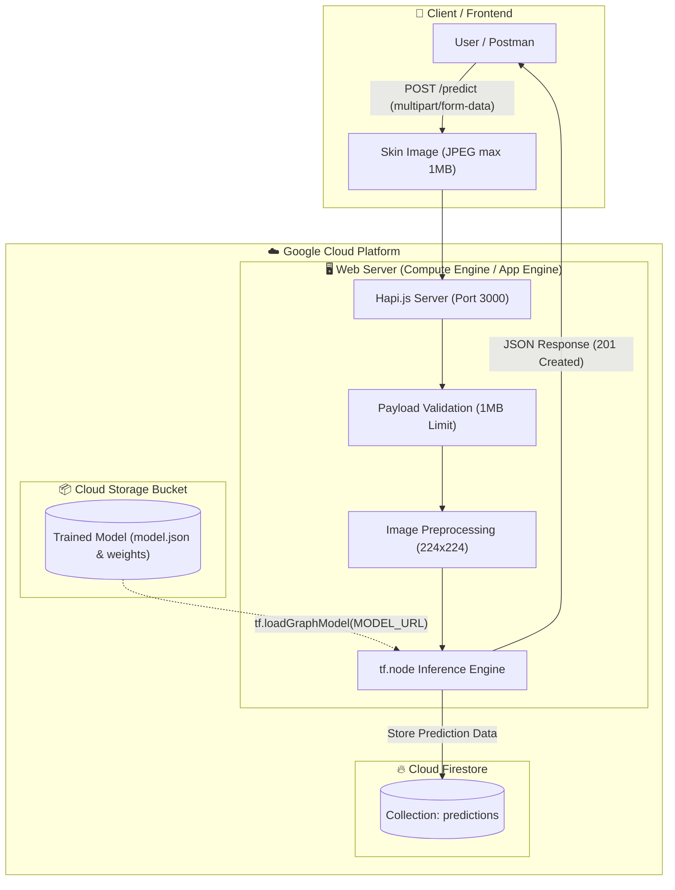

# 🔬 Skin Cancer Detection Web API


A web-based skin cancer prediction application and RESTful API powered by **TensorFlow.js** and **Hapi.js**. The application processes uploaded dermatological skin lesion images to predict potential cancer risks, loads trained deep learning models directly from **Google Cloud Storage**, and automatically records all prediction results into **Google Cloud Firestore**.

---

## 📌 Table of Contents

- [Overview](#-overview)
- [Preview & Architecture](#-preview--architecture)
- [Tech Stack & Cloud Infrastructure](#-tech-stack--cloud-infrastructure)
- [Key Features](#-key-features)
- [System Workflow](#-system-workflow)
- [Project Structure](#-project-structure)
- [API Documentation](#-api-documentation)
- [Getting Started](#-getting-started)
  - [Prerequisites](#prerequisites)
  - [Installation](#installation)
  - [Environment Variables](#environment-variables)
  - [Running the Server](#running-the-server)
- [Deployment Guide](#-deployment-guide)
  - [Google Compute Engine](#1-google-compute-engine)
  - [Google App Engine / Cloud Run](#2-google-app-engine--cloud-run)
- [Security Considerations](#-security-considerations)
- [Author](#-author)

---

## 📖 Overview

Aplikasi ini dikembangkan untuk mengidentifikasi indikasi risiko kanker kulit secara otomatis melalui citra digital. Menggunakan model klasifikasi berbasis Convolutional Neural Network (CNN) yang diekspor ke format TensorFlow.js Graph Model, API ini menerima gambar kulit pasien, melakukan prapemrosesan gambar (resizing ke 224x224 piksel), lalu menghasilkan prediksi apakah lesi kulit tergolong **Cancer** atau **Non-cancer** disertai anjuran medis dan tingkat keyakinan (confidence score).

---

## 🖼 Preview & Architecture

> [!NOTE]
> Letakkan tangkapan layar hasil pengujian (Postman / Web UI / Arsitektur GCP) di folder `assets/preview.png`.




---

## 🚀 Tech Stack & Cloud Infrastructure

| Komponen | Teknologi | Keterangan |
| :--- | :--- | :--- |
| **Backend Framework** | [Hapi.js](https://hapi.dev/) `^21.3.12` | Framework server HTTP modular dan aman |
| **Machine Learning Engine** | [TensorFlow.js Node](https://www.tensorflow.org/js) `^4.22.0` | Server-side deep learning inference |
| **Model Hosting** | **Google Cloud Storage (GCS)** | Menyimpan dan melayani model graph TensorFlow.js |
| **Database** | **Google Cloud Firestore** | NoSQL database untuk menyimpan riwayat hasil prediksi |
| **Deployment / Compute** | **Compute Engine / App Engine** | Server hosting VM atau PaaS pada Google Cloud Platform |
| **Environment Config** | `dotenv` `^16.4.5` | Manajemen environment variable lokal dan produksi |

---

## ✨ Key Features

1. **Automated Image Classification**: Memprediksi gambar lesi kulit ke dalam kategori `Cancer` atau `Non-cancer`.
2. **Confidence Scoring & Medical Advice**: Memberikan saran medis lanjutan berdasarkan hasil inferensi model (*"Segera periksa ke dokter!"* atau *"Penyakit kanker tidak terdeteksi."*).
3. **Cloud Model Fetching**: Model dimuat secara dinamis saat inisialisasi server melalui URL Cloud Storage publik/terproteksi.
4. **Persistent Firestore Logging**: Setiap hasil prediksi disimpan dengan identitas unik UUID dan timestamp ISO secara otomatis ke Firestore.
5. **Strict Input Validation**: Validasi ukuran payload maksimum 1MB (`1.000.000 bytes`) serta penanganan error terpusat (`400 Bad Request`, `413 Payload Too Large`).

---

## 📁 Project Structure

```
ml-web-server-main/
├── assets/
│   ├── README.md                  # Panduan penempatan aset visual
│   └── preview.png                # Tangkapan layar arsitektur / hasil pengujian
├── src/
│   ├── exceptions/
│   │   ├── ClientError.js         # Base custom error class
│   │   └── InputError.js          # Error untuk input atau inferensi tidak valid (400)
│   ├── server/
│   │   ├── handler.js             # Controller pemrosesan prediksi & penyimpanan
│   │   ├── routes.js              # Definisi endpoint POST /predict & batasan payload
│   │   └── server.js              # Inisialisasi Hapi server, CORS, & error handling
│   └── services/
│       ├── inferenceService.js    # Preprocessing gambar (224x224) & inferensi TensorFlow.js
│       ├── loadModel.js           # Pengambilan model graph dari Google Cloud Storage
│       └── storeData.js           # Service penyimpanan data ke Google Cloud Firestore
├── .env.example                   # Template konfigurasi environment
├── .gitignore                     # Filter file sensitif, kredensial, & dependensi
├── package.json                   # Dependensi proyek & npm scripts
└── README.md                      # Dokumentasi utama proyek
```

---

## 📡 API Documentation

### 1. Predict Skin Cancer

Memproses gambar lesi kulit dan mengembalikan hasil klasifikasi kanker serta rekomendasi medis.

- **Endpoint**: `POST /predict`
- **Content-Type**: `multipart/form-data`
- **Payload Limit**: `1.000.000 bytes` (1 MB)

#### Request Body (Multipart Form)
| Field | Tipe | Wajib | Keterangan |
| :--- | :--- | :--- | :--- |
| `image` | `File (Binary)` | Ya | Gambar lesi kulit (format `.jpg` atau `.jpeg`) |

#### Contoh Response Sukses (`201 Created`)
```json
{
  "status": "success",
  "message": "Model is predicted successfully",
  "data": {
    "id": "e7b0c3a2-1b88-466d-9273-df26743841e2",
    "result": "Cancer",
    "suggestion": "Segera periksa ke dokter!",
    "createdAt": "2026-11-02T10:45:12.345Z"
  }
}
```

#### Contoh Response Gagal - Ukuran File Melebihi Batas (`413 Payload Too Large`)
```json
{
  "status": "fail",
  "message": "Payload content length greater than maximum allowed: 1000000"
}
```

#### Contoh Response Gagal - Format Tidak Valid (`400 Bad Request`)
```json
{
  "status": "fail",
  "message": "Terjadi kesalahan dalam melakukan prediksi"
}
```

---

## 🛠 Getting Started

### Prerequisites

Pastikan perangkat Anda sudah terinstal:
- [Node.js](https://nodejs.org/) versi `18.x` atau `20.x`
- `npm` (Node Package Manager)
- Akun Google Cloud Platform dengan API **Firestore** dan **Cloud Storage** aktif

### Installation

1. **Clone repositori**:
   ```bash
   git clone https://github.com/bellalee00/skin-cancer.git
   cd skin-cancer
   ```

2. **Instal dependensi proyek**:
   ```bash
   npm install
   ```

### Environment Variables

Salin berkas konfigurasi template `.env.example` menjadi `.env`:

```bash
cp .env.example .env
```

Sesuaikan nilai di dalam `.env`:
```env
PORT=3000
MODEL_URL=https://storage.googleapis.com/<nama-bucket-anda>/model.json
PROJECT_ID=<gcp-project-id-anda>
```

> [!IMPORTANT]
> Jangan pernah mengunggah file `.env` asli atau file `serviceAccountKey.json` ke repositori publik GitHub!

### Running the Server

- **Mode Pengembangan (Hot Reload)**:
  ```bash
  npm run start:dev
  ```
- **Mode Produksi**:
  ```bash
  npm start
  ```
Server akan berjalan di `http://0.0.0.0:3000` (atau port sesuai variabel `PORT`).

---

## ☁️ Deployment Guide

### 1. Google Compute Engine
1. Buat instance VM baru di Google Cloud Console (OS Ubuntu 20.04/22.04 LTS).
2. Konfigurasikan firewall agar membuka port HTTP (80) atau port aplikasi (3000/8080).
3. Sambungkan ke VM melalui SSH, kemudian instal Node.js dan build-essential:
   ```bash
   curl -fsSL https://deb.nodesource.com/setup_20.x | sudo -E bash -
   sudo apt-get install -y nodejs build-essential
   ```
4. Clone repositori ke VM, konfigurasikan file `.env`, lalu jalankan menggunakan process manager (misal `pm2`):
   ```bash
   sudo npm install -g pm2
   npm install
   pm2 start src/server/server.js --name ml-api
   ```

### 2. Google App Engine / Cloud Run
Jika menggunakan **App Engine**, buat berkas `app.yaml`:
```yaml
runtime: nodejs20
instance_class: F2
env_variables:
  MODEL_URL: "https://storage.googleapis.com/<nama-bucket-anda>/model.json"
  PROJECT_ID: "<gcp-project-id-anda>"
```
Lalu jalankan perintah deploy:
```bash
gcloud app deploy
```

---

## 🔒 Security Considerations

1. **Sanitasi Kredensial**: Repositori ini dilengkapi `.gitignore` untuk mencegah berkas rahasia seperti `serviceAccountKey.json`, `.env`, dan `node_modules` masuk ke version control.
2. **Payload Protection**: Hapi payload parser membatasi ukuran unggahan tepat di `1 MB` untuk mencegah potensi serangan Denial of Service (DoS) melalui pengiriman berkas citra berukuran besar.
3. **Decoupled Architecture**: URL model dan ID proyek Cloud Firestore tidak di-hardcode kaku, melainkan menggunakan environment variable.

---

## 👤 Author

- **Bella Azka Oktavia**
- Machine Learning & Cloud Computing Enthusiast
